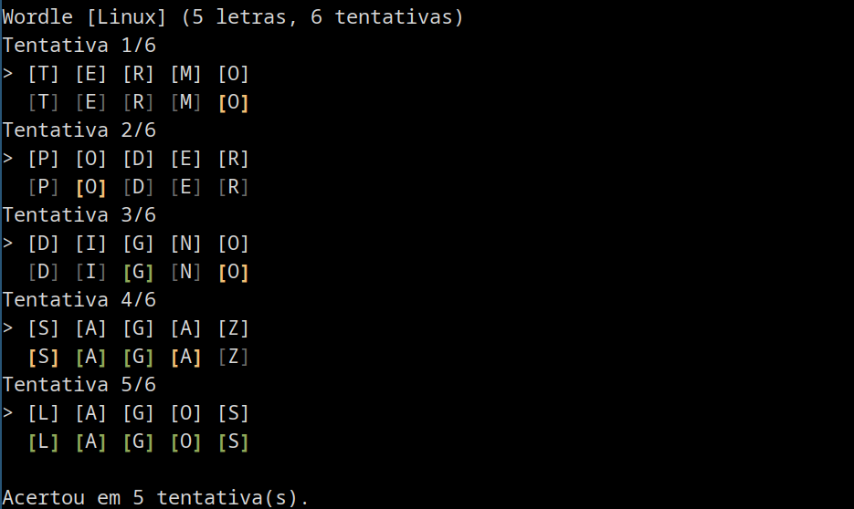

# Wordle in modern cpp

Objetivo é re-criar de forma simples o Wordle no terminal da forma mais podre e horrenda possivel, fazendo o codigo mais nojento de "C++ moderno", usando todas as features preguentas, porcas, nojentas e desgraçadas da pior forma possivel sempre




Baseado nos projetos:

[NadolnyJoao/Wordle_in_C](https://github.com/NadolnyJoao/Wordle_in_C)

[pedrovitor-fs/Wordle_in_CPP](https://github.com/pedrovitor-fs/Wordle_in_CPP)

## uso de ia:
prompts utilizados: 

### google gemini
 - De 10 palavras de 5 letras aleatorias
 - Liste features de c++ 23
 - c++ lambdas usage example
 - @meta ai deixe o codigo pior duvidei `<paste do codigo>` (gemini nao gosta de ser chamado de meta aikkkkkkkkkkkkkkkk)
 - @meta ai sintaxe mais feia de c++ possivel exemplo
 - duvido me dar um totoreal de como fazer input custom no terminal funcionar no indos e no linogs com o maior over engineer possivel em c++ 23 baixar

## Compilar:
Não vou por esforço nessa porcaria, logo não separei em varios translation unit

### linux

```sh
g++ main.cpp -o main -std=c++23
```

### windows


### macos 

usa o clang sla se vira aikkkkkkkkkkkkkk


